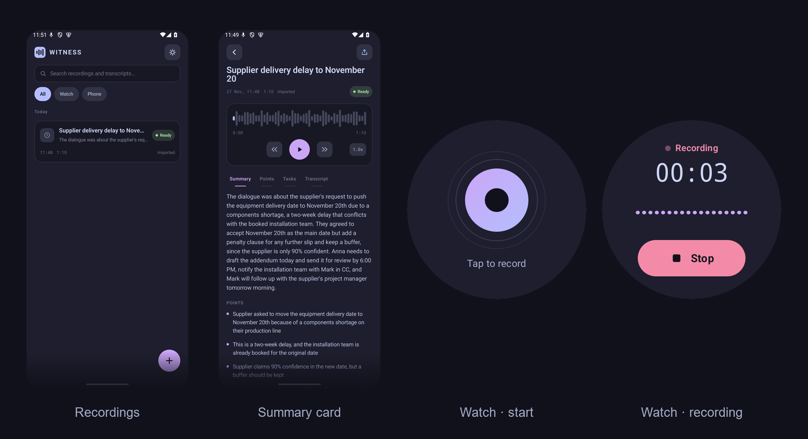

<div align="center">

# 🎙️ Witness

**Voice recorder for Android + Wear OS with AI transcription & summaries**


[](LICENSE)

</div>

---

## What it is & why

**Witness** turns voice recordings into structured notes. You speak — the app transcribes the
speech, splits it by speaker, and generates a title, a short summary, key points and a task list.
No need to re-listen to hour-long recordings or take meeting notes by hand: everything is ready
seconds after you stop recording.

<div align="center">



</div>

The app covers three scenarios:

- 📥 **Audio import** — load an existing audio file from the device and it goes through the full
  pipeline: transcription → summary → key points → tasks.
- 📱 **Phone recording** — built-in recorder with a timer and live equalizer; the recording is
  processed on the phone right away.
- ⌚ **Wear OS watch recording** — a watch recorder that automatically sends the WAV to the paired
  phone over the Wear OS Data Layer and starts processing. With no connection, recordings queue on
  the watch and are delivered automatically as soon as the phone appears.

Transcription and summaries run through **your own models** (ASR + LLM): endpoints, models and keys
are entered in the app settings. Any OpenAI-compatible LLM and any ASR (DashScope protocol or OpenAI
`input_audio`) works. Details in **[releases/config.md](releases/config.md)**.

## 🚀 Install & setup

Ready-made builds live in **[`releases/0.1/`](releases/0.1/)** — no embedded keys; you enter models
and access yourself in settings.

- **[releases/install.md](releases/install.md)** — step-by-step installation on phone and watch
  (for humans; an adb section for AI agents is at the end).
- **[releases/config.md](releases/config.md)** — what you need to make it work: which ASR/LLM models
  fit, which endpoints and keys to enter.

## ✨ Features

- 📥 **Audio import** (WAV) from the device — runs the full pipeline.
- 📱 **Phone recording** — `AudioRecord` WAV 16 kHz mono, foreground service, timer + live equalizer.
- ⌚ **Wear OS recording** — record button, live waveform, auto-delivery to the phone, offline queue.
- 🔄 **Watch → phone sync** over the Wear OS Data Layer (`/recording`): GMS stores the item locally
  and syncs it when a connection appears; `BootReceiver`/`WatchSyncService` trigger delivery.
- 🗣️ **Diarization** — the transcript is split by speaker; speaker colors in the player.
- 🤖 **LLM processing** — title, summary, key points, tasks (with speaker attribution); tabs
  Summary / Points / Tasks / Transcript.
- 🌍 **EN / RU** interface; the summary language follows it.
- 📤 **Export** to `.md` (summary + points + tasks + transcript) and share.
- 🔍 Search and filters (All / Watch / Phone), swipe-to-delete, playback with waveform.

## 🔨 Building from source

```bash
./gradlew :mobile:assembleGitDebug   # clean build, no preset (keys entered in the app)
./gradlew :wear:assembleDebug        # watch APK
```

JDK 17, compileSdk 35, minSdk 26 (watch 30). Gradle wrapper included.

The `dev` flavor reads presets from a local `.env.dev` (git-ignored) — a template is in
[`.env.example`](.env.example). **Never commit secrets.**

## ⌚ Watch → phone transfer

- The watch writes a WAV, enqueues it and puts a `DataItem` `/recording` into the data layer **even
  offline** — GMS keeps the item+asset locally and syncs it to the phone itself when a connection appears.
- The phone's `WearReceiveService` receives the asset, saves the WAV and runs the pipeline.
- `applicationId` is identical (`com.witness`) on phone and watch — the Data Layer routes by package + signature.
- For debugging use an adb bridge: `adb -s emulator-5554 forward tcp:5555 tcp:7276`
  (wear emulators use gRPC 8554, which `adb connect` does not support).

## 🛠️ Stack

Kotlin 2.0.21 · Jetpack Compose + Material 3 · Room · DataStore · Wear OS Data Layer ·
OkHttp · kotlinx-serialization · Coroutines/Flow. ASR/LLM — your endpoints (see [config](releases/config.md)).

## 📂 Documentation

| File | Contents |
|---|---|
| [releases/install.md](releases/install.md) | Installation on phone and watch (human + agent). |
| [releases/config.md](releases/config.md) | ASR/LLM setup: models, endpoints, keys. |
| [releases/0.1/](releases/0.1/) | Version 0.1 builds (APK, no creds) + checksums. |
| [AGENTS.md](AGENTS.md) | Repo conventions for contributors and AI agents. |

## 🔒 Security

- No keys in the repository or in release builds (the `git` flavor has an empty `BuildConfig`).
- `.env.dev` and `local.properties` are git-ignored; the template is [`.env.example`](.env.example).
- Keys are stored locally in the device DataStore and sent only to your ASR/LLM endpoints.

## 📄 License

[PolyForm Noncommercial 1.0.0](LICENSE) — free use, modification and distribution for
**non-commercial purposes only**. **Commercial use is prohibited.**
